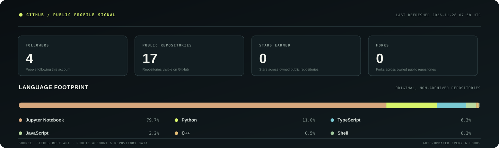

  
  
<strong>Computer Science · Applied AI · Machine Learning · AI Engineering</strong>

  
I build intelligent products — from the first experiment to systems people can use.

  

    <a href="#about">About</a> ·
    <a href="#featured-work">Featured work</a> ·
    <a href="#selected-projects">Selected projects</a> ·
    <a href="#toolkit">Toolkit</a> ·
    <a href="#experience">Experience</a> ·
    <a href="#contact">Contact</a>
  

  

    <a href="https://www.linkedin.com/in/eng-abdelrahman-elharouny/">LinkedIn</a> ·
    <a href="https://www.kaggle.com/abdelrahmanelharouny">Kaggle</a> ·
    <a href="https://www.credly.com/users/abdelrahman-el-harouny.88e314c3">Credentials</a>
  

---

## About

I'm **Abdelrahman El-Harouny**, a Computer Science student at **Damietta University, Egypt**, focused on applied AI and building useful software.

I work across machine learning, LLM applications, RAG, computer vision, and data-driven systems. I enjoy taking a problem from messy data and early experiments to a tested, usable product — with careful evaluation and honest limits along the way.

## Featured work

<table>
  <tr>
    <td width="33%" valign="top">
      <h3><a href="https://github.com/abdelrahmanelharouny/Modrik">Modrik</a></h3>
      AGENTIC REQUIREMENTS ENGINEERING
      
An Arabic-first platform that turns stakeholder conversations and source documents into traceable, reviewable software requirements.

      Agentic AI · RAG · Next.js · TypeScript · PostgreSQL
    </td>
    <td width="33%" valign="top">
      <h3><a href="https://github.com/abdelrahmanelharouny/CropTwist">CropTwist</a></h3>
      GEOSPATIAL AGRICULTURE INTELLIGENCE
      
Field-level decision support connecting satellite and environmental data, agronomic analysis, and crop-planning optimization.

      Python · FastAPI · PostGIS · Remote Sensing · OR-Tools
    </td>
    <td width="33%" valign="top">
      <h3><a href="https://github.com/abdelrahmanelharouny/AlgoVerse-">AlgoVerse</a></h3>
      INTERACTIVE ALGORITHM LEARNING
      
A visual learning environment for exploring algorithms through step-by-step execution, graph views, DP tables, and challenges.

      Algorithms · Visualization · Interactive UI
      
<a href="https://algo-verse-three.vercel.app">Live demo</a>

    </td>
  </tr>
</table>

## Selected projects

| Area | Project | What it explores |
|---|---|---|
| Applied AI | [Smart Contract Assistant](https://github.com/abdelrahmanelharouny/Advanced-smart-contract-assistant) | Grounded contract Q&A using hybrid retrieval, reranking, and citations |
| ML research | [Deepfake Voice Detection](https://github.com/abdelrahmanelharouny/Deepfake-Voice-Detection-with-Fuzzy-Logic-Augmented-Deep-Learning) | Temporal audio models with fuzzy logic and explainability |
| Computer vision | [Egyptian Monuments](https://github.com/abdelrahmanelharouny/Egyptian-Monuments-Landmarks-Classification) | 32-class landmark recognition with out-of-distribution rejection |
| Computer vision | [Smart Classroom](https://github.com/abdelrahmanelharouny/Smart-Classroom-Monitoring) | Detection, tracking, and classroom activity analysis |
| Cybersecurity | [Network Intrusion Detection](https://github.com/abdelrahmanelharouny/Network-Intrusion-Detection) | ML-based network traffic classification |
| Systems | [OrbitX](https://github.com/abdelrahmanelharouny/OrbitX) | Real-time N-body simulation with a custom physics engine |
| Graphics | [3D Maze Explorer](https://github.com/abdelrahmanelharouny/3D-Maze-Explorer) | Procedural maze generation and first-person 3D rendering |

## Toolkit

**Languages:** Python, C++, C, JavaScript, TypeScript, SQL

**AI and data:** PyTorch, TensorFlow, scikit-learn, Pandas, NumPy, OpenCV, YOLO, Hugging Face

**LLM engineering:** RAG, LangChain, embeddings, vector databases, hybrid retrieval, LoRA / PEFT, evaluation

**Backend and infrastructure:** FastAPI, Next.js, PostgreSQL, PostGIS, Docker, Git, Linux, Vercel

## Experience

- **AI Engineer Fellow — Qubeterra AI** · Aug–Oct 2026  
  Built backend components for a multi-agent opinion-simulation platform, including document processing, RAG, retrieval, and analytics.
- **LLMs Intern — Tips Hindawi** · Aug–Oct 2026  
  Worked on RAG pipelines, semantic search, embeddings, and LLM workflows using LangChain and Hugging Face.
- **Programming Tutor — iSchool** · Jul–Aug 2026  
  Delivered **54 programming sessions** for Grade 5–6 students.
- **IT Engineer Intern — Social Nasser Bank** · Sep 2025  
  Supported IT operations, infrastructure checks, and technical troubleshooting.

## Contact

Open to collaboration and opportunities in **Applied AI, Machine Learning, and AI Engineering**.

[LinkedIn](https://www.linkedin.com/in/eng-abdelrahman-elharouny/) · [GitHub](https://github.com/abdelrahmanelharouny) · [Kaggle](https://www.kaggle.com/abdelrahmanelharouny) · [Credly](https://www.credly.com/users/abdelrahman-el-harouny.88e314c3)

  

