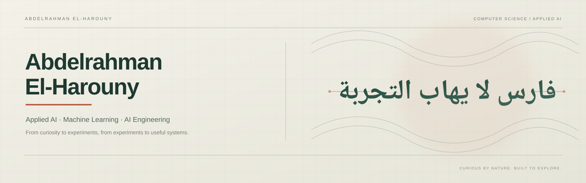
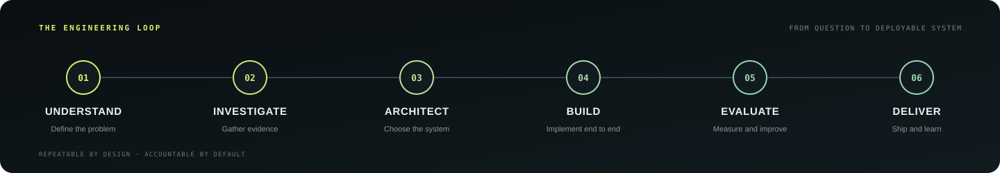

  
  
<strong>COMPUTER SCIENCE · APPLIED AI · MACHINE LEARNING · AI ENGINEERING</strong>

  
I turn complex problems into intelligent systems that people can actually use.

  

    <a href="#profile">Profile</a> ·
    <a href="#systems">Systems</a> ·
    <a href="#portfolio">Portfolio</a> ·
    <a href="#technical-toolkit">Technical toolkit</a> ·
    <a href="#experience">Experience</a> ·
    <a href="#connect">Connect</a>
  

  

    <a href="https://github.com/abdelrahmanelharouny">GitHub</a> ·
    <a href="https://www.linkedin.com/in/eng-abdelrahman-elharouny/">LinkedIn</a> ·
    <a href="https://www.kaggle.com/abdelrahmanelharouny">Kaggle</a> ·
    <a href="https://www.credly.com/users/abdelrahman-el-harouny.88e314c3">Credly</a>
  

---

## 01 / Profile

I'm **Abdelrahman El-Harouny**, a Computer Science undergraduate at **Damietta University, Egypt**, focused on applied AI, machine learning, and engineering useful software products.

My work moves across the full path from problem understanding and data to models, retrieval, evaluation, APIs, and product experiences. I care about why a model works, where it fails, how trustworthy its output is, and what it takes to turn an experiment into a system people can rely on.

I work across Arabic-first agentic workflows, geospatial agriculture decision support, RAG applications, audio deepfake detection, medical and landmark computer vision, cybersecurity experiments, algorithm education, and real-time graphics.

> **How I approach engineering:** evidence over assumptions, evaluation before claims, and complete systems over isolated demos.

## 02 / Systems in progress

<table>
  <tr>
    <td width="50%" valign="top">
      <h3><a href="https://github.com/abdelrahmanelharouny/Modrik">MODRIK — مدرك</a></h3>
      ARABIC-FIRST · AGENTIC REQUIREMENTS ENGINEERING
      
An evidence-driven platform that turns stakeholder conversations and source material into reviewable software requirements. Specialized agents propose and verify; human approval gates preserve decision ownership.

      <strong>Engineering focus</strong>
      <ul>
        <li>Evidence traceability and independent verification.</li>
        <li>Human-controlled workflow gates and conflict analysis.</li>
        <li>Question planning, retrieval, calibration, and evaluation.</li>
        <li>Egyptian Arabic and RTL-first workflows.</li>
      </ul>
      Next.js · TypeScript · PostgreSQL · Prisma · Agentic AI · RAG
    </td>
    <td width="50%" valign="top">
      <h3><a href="https://github.com/abdelrahmanelharouny/CropTwist">CROPTWIST</a></h3>
      GEOSPATIAL AGRICULTURE DECISION INTELLIGENCE
      
A field-level decision-support platform connecting farm records, climate and soil observations, agronomic features, crop-rotation optimization, scenario analysis, and traceable decisions.

      <strong>Engineering focus</strong>
      <ul>
        <li>PostGIS field geometry, observation provenance, and data quality.</li>
        <li>OR-Tools optimization with explicit constraints.</li>
        <li>Immutable, checksummed analysis artifacts.</li>
        <li>Scientific guardrails around unsupported transformations.</li>
      </ul>
      Python · FastAPI · Next.js · PostgreSQL · PostGIS · OR-Tools
    </td>
  </tr>
</table>

### Product engineering

**[AlgoVerse](https://github.com/abdelrahmanelharouny/AlgoVerse-)** is an interactive lab for learning and comparing algorithms through step-by-step execution, DP tables, graph visualizations, code views, challenge mode, and complexity analysis.

[Open the AlgoVerse live demo](https://algo-verse-three.vercel.app) · [View source code](https://github.com/abdelrahmanelharouny/AlgoVerse-)

## 03 / Selected work

The projects below show how I apply one engineering mindset to different problem spaces: understand the domain, build the right technical approach, evaluate it honestly, and make the result usable.

  

### Applied AI and retrieval

| Project | Scope | Technical focus |
|---|---|---|
| [**Advanced Smart Contract Assistant**](https://github.com/abdelrahmanelharouny/Advanced-smart-contract-assistant) | Answers questions over uploaded contracts with grounded responses and chunk-level citations. | FastAPI · ChromaDB · Vector + BM25 retrieval · RRF · Reranking · G-Eval |

### Machine learning and research

<strong>Explore model development, evaluation, and research projects</strong>

| Project | Scope | Technical focus |
|---|---|---|
| [**Neuro-Fuzzy Deepfake Voice Detection**](https://github.com/abdelrahmanelharouny/Deepfake-Voice-Detection-with-Fuzzy-Logic-Augmented-Deep-Learning) | Synthetic vs. authentic speech detection using temporal neural models and a differentiable fuzzy inference layer. | HEAR embeddings · TCN / CNN-LSTM · Fuzzy inference · SHAP. Repository-reported TCN test accuracy: **96.61%**; ROC-AUC: **0.9825**. |
| [**Brain Tumor MRI Classification**](https://github.com/abdelrahmanelharouny/Brain-Tumor-Classification) | Comparing ML and deep-learning baselines under a leakage-aware evaluation protocol. | SVM · XGBoost · ResNet50 baseline · Duplicate audits · Repeated CV · Statistical tests. Repository-reported RBF-SVM test accuracy: **98.0%**; ROC-AUC: **0.998**. |
| [**LungSeg — Chest X-Ray Segmentation**](https://github.com/abdelrahmanelharouny/Lung-Segmentation-Chest-X-Ray-Using-U-Net-EfficientNet-B4) | A provenance-aware lung-field segmentation research pipeline across multiple X-ray sources. | U-Net++-style segmentation · Duplicate-aware splits · Mask QC · Source-held-out evaluation tooling. Research prototype, not a clinical device; the repository notes that the full proposed experiment set has not been completed. |
| [**Egyptian Monuments Classification**](https://github.com/abdelrahmanelharouny/Egyptian-Monuments-Landmarks-Classification) | Recognizing 32 Egyptian landmarks while rejecting inputs outside the target classes. | EfficientNetV2-M · OOD rejection · TensorFlow Lite · INT8 quantization. Repository-reported test top-1 accuracy: **99.71%**. |

Metrics are reported by the linked repositories and have not been independently reproduced for this profile.

### Computer vision and cybersecurity

<strong>Explore perception, tracking, and threat-detection projects</strong>

| Project | Scope | Technical focus |
|---|---|---|
| [**Smart Classroom Monitoring**](https://github.com/abdelrahmanelharouny/Smart-Classroom-Monitoring) | Video-based student detection, identity tracking, and hand-raise analysis. | YOLOv5 · Deep SORT · InsightFace · Keypoint R-CNN · OpenCV |
| [**Network Intrusion Detection**](https://github.com/abdelrahmanelharouny/Network-Intrusion-Detection) | Classifying benign and malicious network traffic using CIC-IDS2017. | Data cleaning · Feature engineering · Classical ML · SimpleRNN |
| [**Zero-Shot Voice-Cloning Detection**](https://github.com/abdelrahmanelharouny/Zeroshot-voice-cloning-detection-Using-Fuzzy-CNNs-to-catch-unseen-deepfakes.) | An early exploration of fuzzy-CNN approaches for unseen voice-cloning detection. | Experimental repository; technical documentation is still being expanded. |

### Systems and visual computing

<strong>Explore simulation, rendering, and procedural systems</strong>

| Project | Scope | Technical focus |
|---|---|---|
| [**OrbitX — Anti-Gravity Solar System**](https://github.com/abdelrahmanelharouny/OrbitX) | N-body simulation with a custom physics engine and procedural planet generation. | C++17 · OpenGL 4.5 · RK4 integration · Collision response · Perlin noise |
| [**3D Maze Explorer**](https://github.com/abdelrahmanelharouny/3D-Maze-Explorer) | First-person 3D maze with procedural generation and real-time rendering. | Python · Pygame · PyOpenGL · DFS maze generation · Camera and collision systems |
| [**OpenGL Pong**](https://github.com/abdelrahmanelharouny/simplest-CG-project-) | Two-player Pong game using a modern OpenGL pipeline. | C++17 · OpenGL 3.3 Core · GLFW · GLAD · GLSL |

## 04 / Technical toolkit

I organize technologies by the work they support, not as a wall of badges.

| Domain | Tools and methods |
|---|---|
| **Programming** | Python · C++ · C · JavaScript · TypeScript · SQL |
| **Data science** | Pandas · NumPy · Matplotlib · Seaborn · EDA · Data cleaning · Statistical analysis · Feature engineering |
| **Machine learning** | Scikit-learn · Supervised and unsupervised learning · Model evaluation · Feature selection |
| **Deep learning and vision** | PyTorch · TensorFlow · Keras · CNNs · Transfer learning · OpenCV · YOLOv5 |
| **Generative AI and NLP** | LLMs · RAG · Prompt engineering · LangChain · Hugging Face · Embeddings · Vector databases · LoRA / PEFT |
| **Backend and data** | FastAPI · PostgreSQL · MySQL · SQLite · SQL Server · ChromaDB · PostGIS |
| **Engineering tools** | Git · GitHub · Jupyter · VS Code · Linux · Vercel · Docker |
| **Graphics and algorithms** | OpenGL · GLSL · Pygame · Data structures · Dynamic programming · Graph algorithms |

## 05 / Engineering principles

  

- **Understand before modeling.** Define the problem, constraints, data, and intended user.
- **Research before assuming.** Verify sources, inspect data quality, and record limitations.
- **Architect for the full path.** Data, models, retrieval, APIs, interfaces, and operations are connected.
- **Evaluate as part of the product.** Baselines, failure analysis, uncertainty, and reproducibility matter.
- **Keep people in control.** AI should support accountable decisions, not silently make them.
- **Document what is not proven.** A useful project explains its boundaries as clearly as its capabilities.

## 06 / Experience and community

| Experience | Contribution |
|---|---|
| **AI Engineer Fellow — Qubeterra AI** · Aug–Oct 2026 | Developed backend components for a multi-agent opinion-simulation platform, integrating RAG pipelines, document parsing and chunking, embeddings, context retrieval, analytics, and collaborative Git workflows. |
| **LLMs Intern — Tips Hindawi** · Aug–Oct 2026 | Built and evaluated RAG pipelines with vector databases, semantic search, and embeddings; developed LLM workflows with LangChain and Hugging Face, and explored LoRA/PEFT and inference optimization. |
| **Programming Tutor — iSchool (DEMI/DECI)** · Jul–Aug 2026 | Delivered **54 programming sessions** for Grade 5–6 students, teaching programming fundamentals and computational thinking through guided exercises and projects. |
| **GenAI Batch — Commercial International Bank (CIB)** · Jul 2026 | Completed an enterprise-focused GenAI program covering Responsible AI, human-centric AI, AI risk and governance, open-source AI, and digital transformation. |
| **IT Engineer Intern — Social Nasser Bank** · Sep 2025 | Supported enterprise IT operations, hardware/software setup, network and infrastructure checks, access-control procedures, and structured technical troubleshooting. |

**Community and leadership**

- **Data Science Mentor**, CIS Data Science Committee — Mansoura University (Dec 2025–Aug 2026): mentored junior members and reviewed Python, data science, and ML project work.
- **Data Science Member**, CAT Reloaded and CIS — Mansoura University.
- **Competitive Programming Trainee**, ACPC — Damietta University: algorithms, data structures, and problem solving.

## 07 / Continuous learning

<strong>Selected programs and credentials</strong>

- **NVIDIA Deep Learning Institute:** Building RAG Agents with LLMs; Building LLM Applications with Prompt Engineering; Getting Started with Deep Learning.
- **Applied AI and engineering:** Innovegypt — ITIDA; HCIA-AI — Huawei / MOY; Generative AI Advanced — ITI; Computer Vision Summer Training — NTI.
- **Cloud, data, and professional development:** AWS AI Practitioner Challenge; AWS Educate Machine Learning Foundations; AI & ML Summer Camp — Sprints × Microsoft; Data Science Job Simulation — British Airways / Forage.
- **IBM SkillsBuild:** Code Generation & Optimization Using IBM Granite; Working in a Digital World: Professional Skills; Data Fundamentals.
- **Other programs:** McKinsey.org Forward Program.

Public credential records: [Credly profile](https://www.credly.com/users/abdelrahman-el-harouny.88e314c3) · [AWS ML Foundations](https://www.credly.com/badges/9b363e10-20fc-44d1-9de8-fdc6cd20aa89/public_url) · [IBM Granite](https://www.credly.com/badges/fe401d3b-ec4d-44c0-b2a6-649daa7a4c8f/public_url) · [IBM Professional Skills](https://www.credly.com/badges/21dfaa95-d93a-4032-a383-e49261f678b9/public_url) · [McKinsey Forward](https://www.credly.com/badges/c61bbeb9-ce83-4489-a29d-9607adaa0b1f/public_url).

## 08 / Current focus

- **Modrik:** agentic requirements engineering, Arabic-first intelligence, retrieval, evaluation, and trust mechanisms.
- **CropTwist:** scientifically grounded geospatial decision support, data quality, optimization, and traceable analytics.
- **AlgoVerse:** algorithm learning, interactive visualization, and product experience.

## 09 / GitHub activity

The dashboard below is generated from GitHub's public API. It tracks account-level signals and the language footprint of public repositories. GitHub Actions refreshes the image automatically every six hours.

  

  

## 10 / Connect

I'm open to thoughtful conversations, engineering collaboration, and opportunities around **Machine Learning, Applied AI, AI Engineering, and intelligent products**.

  <a href="https://github.com/abdelrahmanelharouny">GitHub</a> ·
  <a href="https://www.linkedin.com/in/eng-abdelrahman-elharouny/">LinkedIn</a> ·
  <a href="https://www.kaggle.com/abdelrahmanelharouny">Kaggle</a> ·
  <a href="https://www.credly.com/users/abdelrahman-el-harouny.88e314c3">Credly</a>

Curious by default. Precise about the work. Always building.

