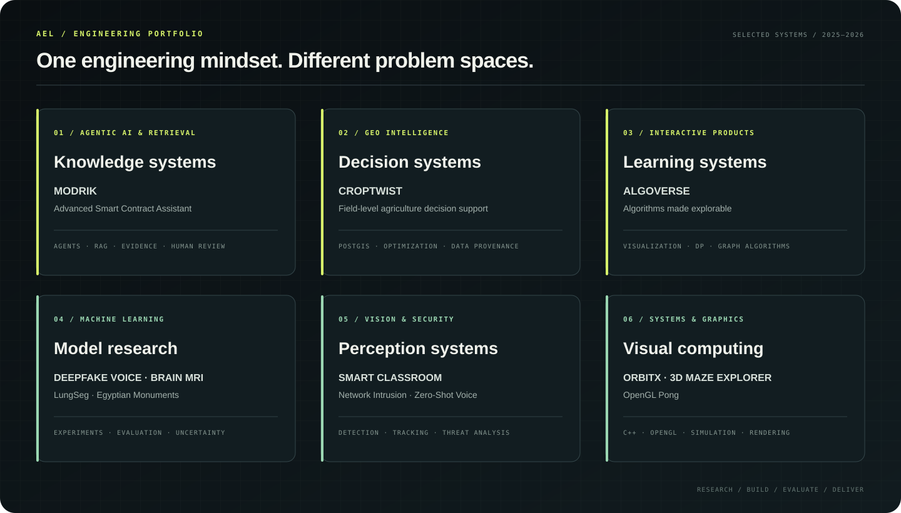

  
  <h1>Curiosity starts the idea. Engineering makes it real.</h1>
  
<strong>Computer Science</strong> · <strong>Applied AI & Machine Learning</strong> · <strong>AI Engineering</strong>

  
I turn real-world problems into intelligent systems — from the first question to a product people can use.

  

    
  

  

    <a href="#about">About</a> · <a href="#systems">Systems</a> · <a href="#portfolio">Portfolio</a> ·
    <a href="#skills">Skills</a> · <a href="#experience">Experience</a> · <a href="#learning">Learning</a> · <a href="#connect">Connect</a>
  

  

    
    
    
  

  

    
    
    
    
    
  

  
Profile views count counter loads, not unique people. The number is a lightweight reach signal, not an audience census.

  

    <a href="#choose-your-route">🧭 CHOOSE YOUR ROUTE</a> ·
    <a href="#live-telemetry">📊 LIVE TELEMETRY</a> ·
    <a href="#skills">🧰 SKILL ARCADE</a>
  

---

## 🧭 Choose your route

Not everyone visits for the same reason. Pick a path and jump straight into the part of my work that matters to you.

🧑‍💼 <strong>I'm hiring — show me the signal</strong>

Start with the systems I build, the problems I solve, and the experience behind them.

- [Flagship systems: Modrik & CropTwist](#systems)
- [Selected portfolio and project outcomes](#portfolio)
- [Technical skills by domain](#skills)
- [Work experience, teaching, and mentoring](#experience)
- [Get in touch](#connect)

🛠️ <strong>I'm an engineer — show me the architecture</strong>

Explore implementation choices, tools, and engineering trade-offs.

- [Agentic systems and RAG](#applied-ai)
- [ML research and evaluation](#ml-research)
- [Computer vision and security](#vision-security)
- [Systems, algorithms, and graphics](#systems-graphics)
- [How I build](#how-i-build)

🔬 <strong>I'm a researcher — show me the experiments</strong>

Explore methods, evaluation, uncertainty, and what each repository does—and does not—claim.

- [Machine learning and research projects](#ml-research)
- [Applied AI and retrieval systems](#applied-ai)
- [Engineering loop and evaluation mindset](#how-i-build)
- [Learning archive](#learning)

## `01 / WHOAMI` — The engineer behind the systems

I'm **Abdelrahman El-Harouny**, a Computer Science undergraduate at **Damietta University, Egypt**, focused on applied AI, machine learning, and building useful software products.

I work across the path from **problem understanding and data** to **models, retrieval, evaluation, APIs, and product experiences**. I care about why a model works, where it fails, how trustworthy its output is, and what it takes to turn an experiment into a system people can use.

My work spans Arabic-first agentic workflows, geospatial agriculture decision support, RAG applications, audio deepfake detection, medical and landmark computer vision, cybersecurity experiments, algorithm education, and real-time graphics.

> **My engineering bias:** evidence over assumptions, evaluation before claims, and complete systems over isolated demos.

  
  
  
  

## `02 / CONTROL DECK` — What I'm building

<table>
  <tr>
    <td width="50%" valign="top">
      <h3><a href="https://github.com/abdelrahmanelharouny/Modrik">01 / MODRIK — مدرك</a></h3>
      ARABIC-FIRST · AGENTIC REQUIREMENTS ENGINEERING
      
An evidence-driven platform for turning stakeholder conversations and source material into reviewable software requirements. Specialized agents propose and verify; human approval gates preserve decision ownership.

      
<strong>Engineering focus</strong>

      <ul><li>Evidence traceability and independent verification.</li><li>Human-controlled workflow gates and conflict analysis.</li><li>Question planning, retrieval, calibration, and evaluation.</li><li>Egyptian Arabic and RTL-first workflows.</li></ul>
      Next.js · TypeScript · PostgreSQL · Prisma · Agentic AI · RAG
    </td>
    <td width="50%" valign="top">
      <h3><a href="https://github.com/abdelrahmanelharouny/CropTwist">02 / CROPTWIST</a></h3>
      GEOSPATIAL AGRICULTURE DECISION INTELLIGENCE
      
A field-level decision-support platform connecting farm records, climate and soil observations, agronomic features, crop-rotation optimization, scenario analysis, and traceable decisions.

      
<strong>Engineering focus</strong>

      <ul><li>PostGIS field geometry, observation provenance, and data quality.</li><li>OR-Tools optimization with explicit constraints.</li><li>Immutable, checksummed analysis artifacts.</li><li>Scientific guardrails around unsupported transformations.</li></ul>
      Python · FastAPI · Next.js · PostgreSQL · PostGIS · OR-Tools
    </td>
  </tr>
</table>

### `03 / PRODUCT BUILDING` — Learning through interactive systems

**[AlgoVerse](https://github.com/abdelrahmanelharouny/AlgoVerse-)** is an interactive lab for learning and comparing algorithms through step-by-step execution, DP tables, graph visualizations, code views, challenge mode, and complexity analysis.

  
  

## `04 / INTELLIGENCE MAP` — One mindset, multiple domains

My repositories are not one narrow track. They show how I apply engineering thinking across different problem spaces. Choose a domain below to jump to its project collection.

  

  <a href="#applied-ai">Applied AI & RAG</a> · <a href="#ml-research">ML & Research</a> ·
  <a href="#vision-security">Vision & Security</a> · <a href="#systems-graphics">Systems & Graphics</a>

### `04A / APPLIED AI & RAG` — Retrieval, agents, and grounded applications

| Project | What it explores | Technical signals |
|---|---|---|
| [**Advanced Smart Contract Assistant**](https://github.com/abdelrahmanelharouny/Advanced-smart-contract-assistant) | Asking questions over uploaded contracts with grounded answers and chunk-level citations. | FastAPI · ChromaDB · Vector + BM25 retrieval · RRF · Reranking · G-Eval |

### `04B / MACHINE LEARNING & RESEARCH` — Models, evaluation, and uncertainty

<strong>Explore 4 ML and research projects</strong> — expand for methods and reported results

| Project | What it explores | Technical signals |
|---|---|---|
| [**Neuro-Fuzzy Deepfake Voice Detection**](https://github.com/abdelrahmanelharouny/Deepfake-Voice-Detection-with-Fuzzy-Logic-Augmented-Deep-Learning) | Synthetic vs. authentic speech detection using temporal neural models and a differentiable fuzzy inference layer. | HEAR embeddings · TCN / CNN-LSTM · Fuzzy inference · SHAP. **Repository-reported TCN test accuracy: 96.61%; ROC-AUC: 0.9825.** |
| [**Brain Tumor MRI Classification**](https://github.com/abdelrahmanelharouny/Brain-Tumor-Classification) | Comparing ML and deep-learning baselines under a leakage-aware evaluation protocol. | SVM · XGBoost · ResNet50 baseline · Duplicate audits · Repeated CV · Statistical tests. **Repository-reported RBF-SVM test accuracy: 98.0%; ROC-AUC: 0.998.** |
| [**LungSeg — Chest X-Ray Segmentation**](https://github.com/abdelrahmanelharouny/Lung-Segmentation-Chest-X-Ray-Using-U-Net-EfficientNet-B4) | A provenance-aware lung-field segmentation research pipeline across multiple X-ray sources. | U-Net++-style segmentation · Duplicate-aware splits · Mask QC · Source-held-out evaluation tooling. *Research prototype, not a clinical device; the repository notes that the full proposed experiment set has not been completed.* |
| [**Egyptian Monuments Classification**](https://github.com/abdelrahmanelharouny/Egyptian-Monuments-Landmarks-Classification) | Recognizing 32 Egyptian landmarks while rejecting inputs outside the target classes. | EfficientNetV2-M · OOD rejection · TensorFlow Lite · INT8 quantization. **Repository-reported test top-1 accuracy: 99.71%.** |

Metrics above are reported by the linked repositories; they have not been independently reproduced for this profile.

### `04C / COMPUTER VISION & CYBERSECURITY` — Perception and threat detection

<strong>Explore 3 applied projects</strong> — expand for the project scope

| Project | What it explores | Technical signals |
|---|---|---|
| [**Smart Classroom Monitoring**](https://github.com/abdelrahmanelharouny/Smart-Classroom-Monitoring) | Video-based student detection, identity tracking, and hand-raise analysis. | YOLOv5 · Deep SORT · InsightFace · Keypoint R-CNN · OpenCV |
| [**Network Intrusion Detection**](https://github.com/abdelrahmanelharouny/Network-Intrusion-Detection) | Classifying benign and malicious network traffic using CIC-IDS2017. | Data cleaning · Feature engineering · Classical ML · SimpleRNN |
| [**Zero-Shot Voice-Cloning Detection**](https://github.com/abdelrahmanelharouny/Zeroshot-voice-cloning-detection-Using-Fuzzy-CNNs-to-catch-unseen-deepfakes.) | An early exploration of fuzzy-CNN approaches for unseen voice-cloning detection. | Experimental repository; technical documentation is still being expanded. |

### `04D / SYSTEMS & VISUAL COMPUTING` — Simulation, rendering, and algorithms

<strong>Explore 3 systems and graphics projects</strong> — expand for implementation details

| Project | What it explores | Technical signals |
|---|---|---|
| [**OrbitX — Anti-Gravity Solar System**](https://github.com/abdelrahmanelharouny/OrbitX) | N-body simulation with a custom physics engine and procedural planet generation. | C++17 · OpenGL 4.5 · RK4 integration · Collision response · Perlin noise |
| [**3D Maze Explorer**](https://github.com/abdelrahmanelharouny/3D-Maze-Explorer) | First-person 3D maze with procedural generation and real-time rendering. | Python · Pygame · PyOpenGL · DFS maze generation · Camera and collision systems |
| [**OpenGL Pong**](https://github.com/abdelrahmanelharouny/simplest-CG-project-) | Two-player Pong game using a modern OpenGL pipeline. | C++17 · OpenGL 3.3 Core · GLFW · GLAD · GLSL |

---

## `05 / SKILL ARCADE` — The tools behind the ideas

I organize tools by the work they support, not as one long badge wall. The visual stack below is a quick scan; the map underneath shows how I use these tools in real projects.

  

| Domain | Skills & technologies |
|---|---|
| **Programming** | Python · C++ · C · JavaScript · SQL |
| **Data science** | Pandas · NumPy · Matplotlib · Seaborn · EDA · Data cleaning · Statistical analysis · Feature engineering |
| **Machine learning** | Scikit-learn · Supervised / unsupervised learning · Model evaluation · Feature selection |
| **Deep learning & vision** | PyTorch · TensorFlow · Keras · CNNs · Transfer learning · OpenCV · YOLOv5 |
| **Generative AI & NLP** | LLMs · RAG · Prompt engineering · LangChain · Hugging Face · Embeddings · Vector databases · LoRA / PEFT |
| **Backend & data** | FastAPI · PostgreSQL · MySQL · SQLite · SQL Server · ChromaDB · PostGIS |
| **Engineering tools** | Git · GitHub · Jupyter · VS Code · Linux · Vercel · Docker |
| **Graphics & algorithms** | OpenGL · GLSL · Pygame · Data structures · Dynamic programming · Graph algorithms |

<strong>Explore my working toolkit by layer</strong>

**01 — Build & code**

`Python` `C++` `C` `JavaScript` `SQL` `Git` `Linux`

**02 — Data & classical ML**

`Pandas` `NumPy` `Scikit-learn` `EDA` `Feature Engineering` `Statistical Analysis` `Model Evaluation`

**03 — Deep learning & perception**

`PyTorch` `TensorFlow` `Keras` `CNNs` `Transfer Learning` `OpenCV` `YOLOv5`

**04 — LLM & retrieval systems**

`RAG` `LangChain` `Hugging Face` `Embeddings` `Vector Databases` `Prompt Engineering` `LoRA / PEFT`

**05 — Data platforms & services**

`FastAPI` `PostgreSQL` `MySQL` `SQLite` `SQL Server` `PostGIS` `ChromaDB`

**06 — Product & visualization**

`Next.js` `TypeScript` `Vercel` `OpenGL` `GLSL` `Pygame` `Interactive Visualization`

## `06 / HOW I BUILD` — My engineering loop

  

- **Understand before modeling.** Define the problem, constraints, data, and intended user.
- **Research before assuming.** Verify sources, inspect data quality, and record limitations.
- **Architect for the full path.** Data, models, retrieval, APIs, interfaces, and operations are connected.
- **Evaluate as part of the product.** Baselines, failure analysis, uncertainty, and reproducibility matter.
- **Keep people in control.** AI should support accountable decisions, not silently make them.
- **Document what is not proven.** A useful project explains its boundaries as clearly as its capabilities.

## `07 / EXPERIENCE & COMMUNITY` — Work, teaching, and collaboration

| Experience | Contribution |
|---|---|
| **AI Engineer Fellow — Qubeterra AI** · Aug–Oct 2026 | Developed backend components for a multi-agent opinion-simulation platform, integrating RAG pipelines, document parsing and chunking, embeddings, context retrieval, analytics, and collaborative Git workflows. |
| **LLMs Intern — Tips Hindawi** · Aug–Oct 2026 | Built and evaluated RAG pipelines with vector databases, semantic search, and embeddings; developed LLM workflows with LangChain and Hugging Face, and explored LoRA/PEFT and inference optimization. |
| **Programming Tutor — iSchool (DEMI/DECI)** · Jul–Aug 2026 | Delivered **54 programming sessions** for Grade 5–6 students, teaching programming fundamentals and computational thinking through guided exercises and projects. |
| **GenAI Batch — Commercial International Bank (CIB)** · Jul 2026 | Completed an enterprise-focused GenAI program covering Responsible AI, human-centric AI, AI risk and governance, open-source AI, and digital transformation. |
| **IT Engineer Intern — Social Nasser Bank** · Sep 2025 | Supported enterprise IT operations, hardware/software setup, network and infrastructure checks, access-control procedures, and structured technical troubleshooting. |

**Community & leadership**

- **Data Science Mentor**, CIS Data Science Committee — Mansoura University (Dec 2025–Aug 2026): mentored junior members and reviewed Python, data science, and ML project work.
- **Data Science Member**, CAT Reloaded and CIS — Mansoura University.
- **Competitive Programming Trainee**, ACPC — Damietta University: algorithms, data structures, and problem solving.

## `08 / CONTINUOUS LEARNING` — Selected programs & credentials

<strong>Explore training and certifications</strong> — expand the learning archive

- **NVIDIA Deep Learning Institute:** Building RAG Agents with LLMs; Building LLM Applications with Prompt Engineering; Getting Started with Deep Learning.
- **Applied AI & engineering:** Innovegypt — ITIDA; HCIA-AI — Huawei / MOY; Generative AI Advanced — ITI; Computer Vision Summer Training — NTI.
- **Cloud, data & professional development:** AWS AI Practitioner Challenge; AWS Educate Machine Learning Foundations; AI & ML Summer Camp — Sprints × Microsoft; Data Science Job Simulation — British Airways / Forage.
- **IBM SkillsBuild:** Code Generation & Optimization Using IBM Granite; Working in a Digital World: Professional Skills; Data Fundamentals.
- **Other programs:** McKinsey.org Forward Program.

Public credential records: [Credly profile](https://www.credly.com/users/abdelrahman-el-harouny.88e314c3) · [AWS ML Foundations](https://www.credly.com/badges/9b363e10-20fc-44d1-9de8-fdc6cd20aa89/public_url) · [IBM Granite](https://www.credly.com/badges/fe401d3b-ec4d-44c0-b2a6-649daa7a4c8f/public_url) · [IBM Professional Skills](https://www.credly.com/badges/21dfaa95-d93a-4032-a383-e49261f678b9/public_url) · [McKinsey Forward](https://www.credly.com/badges/c61bbeb9-ce83-4489-a29d-9607adaa0b1f/public_url).

## `09 / CURRENT FOCUS`

- **Modrik:** agentic requirements engineering, Arabic-first intelligence, retrieval, evaluation, and trust mechanisms.
- **CropTwist:** scientifically grounded geospatial decision support, data quality, optimization, and traceable analytics.
- **AlgoVerse:** algorithm learning, interactive visualization, and product experience.

## `10 / LIVE TELEMETRY` — Activity, momentum & reach

A quick pulse of the work, the community around it, and the projects documented here.

  
  

  

📈 <strong>Open the activity graph</strong> — recent contribution rhythm

  

🏆 <strong>Open the achievement shelf</strong> — GitHub milestones

  

These cards use community-hosted services and may be cached, rate-limited, or temporarily unavailable. Top Languages reflects public repository code volume—not a measurement of skill level. Contribution and streak cards reflect GitHub activity, not product quality.

## `11 / LIVE ENGINEERING PULSE` — The contribution trail

The contribution animation below is generated automatically by this repository's GitHub Actions workflow. It reflects the GitHub contribution graph; it is an activity view, not a measure of engineering quality.

  <picture>
    <source media="(prefers-color-scheme: dark)" srcset="https://raw.githubusercontent.com/abdelrahmanelharouny/abdelrahmanelharouny/output/github-contribution-grid-snake-dark.svg" />
    <source media="(prefers-color-scheme: light)" srcset="https://raw.githubusercontent.com/abdelrahmanelharouny/abdelrahmanelharouny/output/github-contribution-grid-snake.svg" />
    
  </picture>

<strong>Open live GitHub statistics</strong> — language mix and account activity

  
  

Stats are provided by a community-hosted service and may be rate-limited or temporarily unavailable.

## `12 / CONNECT` — Let's build something meaningful

I'm open to thoughtful conversations, engineering collaboration, and opportunities around **Machine Learning, Applied AI, AI Engineering, and intelligent products**.

  
  
  
  

Curious by default. Serious about the craft. Always building the next thing.

